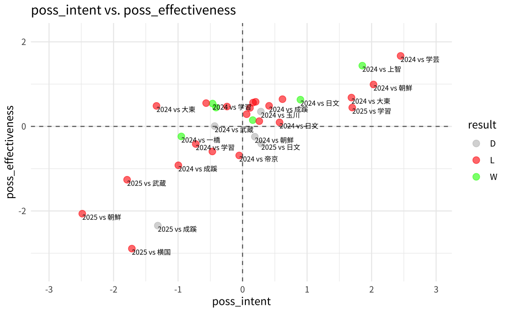
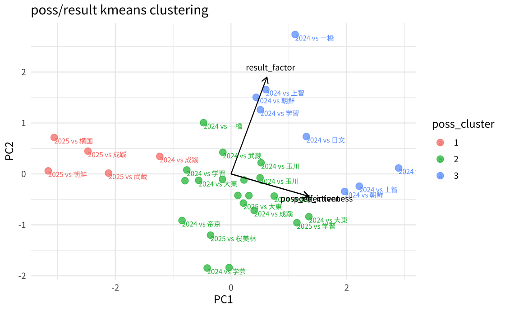
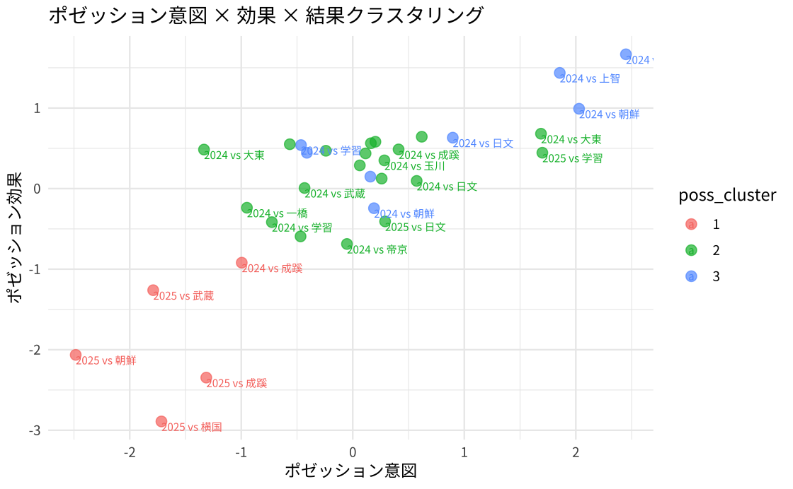

# UTokyo Men's Soccer: Possession Style vs. Results

Match-level analysis of the University of Tokyo Men's Soccer Team (東京大学運動会ア式蹴球部) across the 2024 and 2025 seasons. I built it as a data analyst intern with the team (Apr–Aug 2025).

> The underlying match data belongs to the team and is kept private; see [Data](#data).

**Question:** The team plays a possession-based style. Does *how* it keeps the ball actually connect to results, and what changed from 2024 to 2025?



## Approach

The raw data is 32 matches with ~100 team-level stats per match (passes by direction and length, build-up sequences, switches of play, pass speed, xG, shots, box entries, duels, ball losses), for both the team and its opponents. Individual stats are noisy and heavily correlated, so I compressed them into three interpretable scores with **single-factor factor analysis** (`psych::fa`, minres, regression scores). I used parallel analysis to check the factor count and dropped near-zero-variance columns first.

| Score | What it captures | Main inputs |
| --- | --- | --- |
| **Possession intent** | How much the team *tries* to progress through possession | Pass counts by direction, forward-pass and long-pass ratios, forward passes from wide areas, switches of play, lateral pass speed, number of build-ups |
| **Possession effectiveness** | How *well* that possession is executed | Pass completion %, forward-pass ratio, long-pass ratio and success %, forward passes from wide areas, switches of play, consistency of completed lateral pass speed |
| **Outcome factor** | How the match went, beyond the scoreline: results and chance creation for both sides | Goal difference, xG for/against, shots for/against, penalty-area entries for/against, duel win %, receptions between the lines (バイタル) |

Then:
1. **Possession maps.** Intent vs. effectiveness for each match, colored by W/D/L, for both seasons together and separately.
2. **Clustering.** k-means (k = 3, chosen by elbow plot) on the three standardized scores.
3. **PCA biplot.** Projects the clusters onto two principal components, with loading arrows, to show how the three scores relate.

## Findings



Cluster averages (all scores standardized, so 0 = the two-season average):

| Cluster | Possession intent | Possession effectiveness | Outcome factor | Reading |
| --- | --- | --- | --- | --- |
| 1 | −1.66 | −1.90 | −0.43 | Possession collapsed: the team neither tried to build nor executed |
| 2 | +0.08 | +0.19 | −0.39 | Typical possession, below-average outcomes (the majority of matches) |
| 3 | +0.84 | +0.70 | +1.25 | Everything clicked, almost all 2024 |

- **Possession and outcomes are only loosely linked.** In the PCA biplot, the intent and effectiveness arrows point almost the same way, while the outcome arrow is close to perpendicular to both. Wins came across nearly the whole range of possession intent, and the best outcome score of the sample (2024 vs. 一橋) came at roughly average intent.
- **A possession collapse didn't mean worse results than usual.** Cluster 1 sits far below average on both possession scores, yet its outcome factor (−0.43) is about the same as the typical cluster 2 (−0.39). What separated good matches from the rest was cluster 3, where possession *and* chance creation were both strong.
- **2024 → 2025: the possession game broke down.** Four of the five cluster-1 matches are from 2025 (vs. 横国, 朝鮮, 成蹊, 武蔵). Every 2025 match scored below average on the outcome factor, and none were wins. Even 2025's most effective possession matches (vs. 帝京, 桜美林) produced the season's worst outcomes, so executing the style well no longer protected results.



Season-split maps: [2024](plots/2024poss_intent_poss_effectiveness.png) · [2025](plots/2025poss_intent_poss_effectiveness.png)

## Limitations

- **Small sample.** 32 matches is thin for factor analysis and clustering, so treat the clusters as descriptive rather than stable segments.
- **Overlapping inputs.** Intent and effectiveness share four inputs (forward-pass ratio, long-pass ratio, wide forward passes, switches of play). That partly explains why they move together. A cleaner version would give each score its own disjoint set of inputs.
- **Outcome factor includes goals and xG.** It summarizes results rather than predicting them, so nothing here is a forecast.
- Ball-loss-by-zone stats were collected but not used yet. Adding them as a "risk" score is the natural next step.

## Repository layout

```
report.Rmd          Full analysis: factor scores, possession maps, k-means, PCA
functions.R         Data loading and the possession-map plotting helper
plots/              Figures referenced above
Todai-Ashiki.Rproj  RStudio project
```

## Data

**The match data is not included.** The team collected these stats for its own internal analysis and shared them with me as an intern. They aren't mine to publish, so this repo contains only my code and the resulting figures. Player-level GPS tracking data from the internship is excluded for the same reason.

To run the analysis on data with the same structure, place a CSV at `data/match_stats.csv` with one row per match: `season`, `対戦相手` (opponent), and the stat columns referenced in `report.Rmd`, using the original Japanese column names (e.g., `パス数`, `前方パス比率`, `buildup_回数`, `xg`, `被xg`). Columns prefixed with `被` are the opponent's values.

## Running it

```r
install.packages(c("tidyverse", "psych", "reshape2", "corrplot", "showtext"))
```

Open `Todai-Ashiki.Rproj` in RStudio and knit `report.Rmd`. Plots use Noto Sans JP through `showtext`, which downloads the font on first run.
